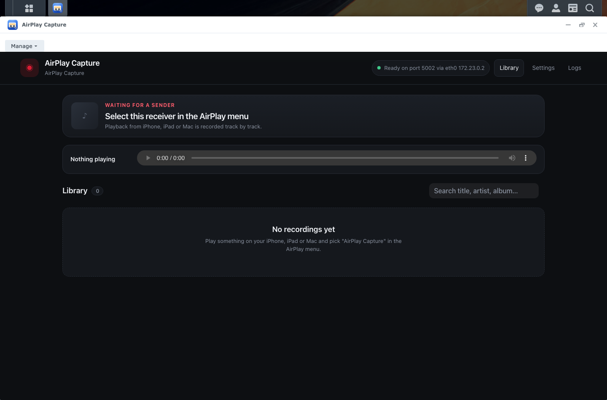
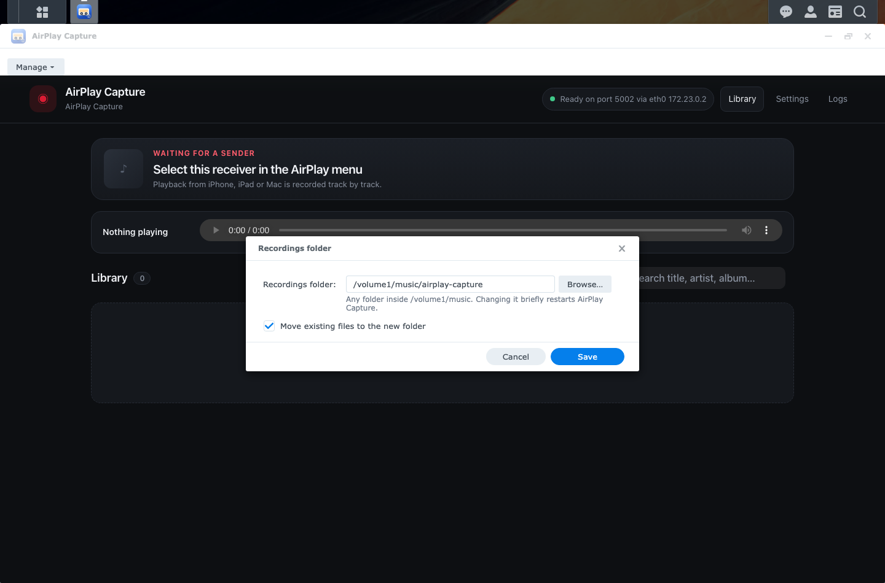
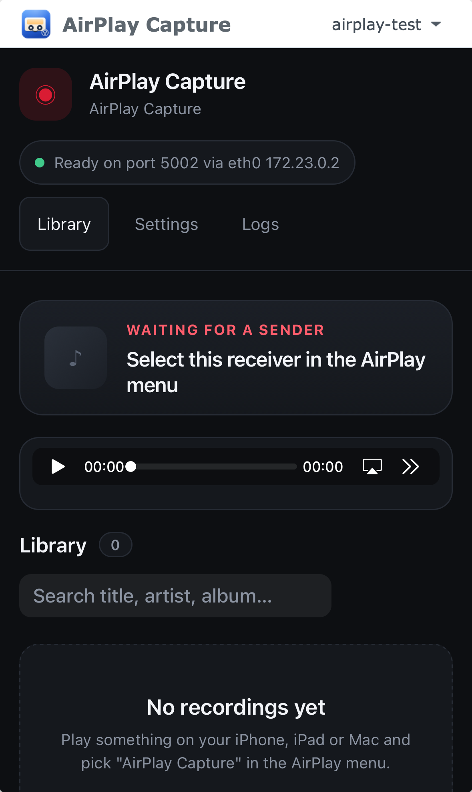

# Synology Docker Bridge

A small, generic runtime that puts an existing Docker web UI into a DSM desktop window and adds
NAS-aware controls without teaching the application image anything about Synology.

The application stays a normal OCI image. The bridge is an additional container in the package's
compose project. DSM's own nginx reverse-proxies the app under
`/webman/3rdparty/<id>/proxy/`, so the desktop window uses DSM's own HTTP and HTTPS ports — no
extra port, no firewall rule, no certificate exception. The bridge also exposes a localhost-only
control API for the package UI.

```
DSM desktop icon                       Login Portal address (phones, browser tabs)
  └─ SYNO.SDS.AppWindow (Ext, package UI)  ◄── https://<nas>:<dsm-port>/<id>/
       ├─ toolbar (administrators only): Manage ▾ (folder…, Open on phones…)
       └─ iframe: /webman/3rdparty/<id>/app.html (same origin as DSM)
            └─ iframe: /webman/3rdparty/<id>/proxy/app/
                 └─ DSM nginx (5000/5001) ──► 127.0.0.1:<bridge-control-port>
                      └─ bridge proxy ──► 127.0.0.1:<internal-port>
```

## Example: AirPlay Capture in DSM

This is [AirPlay Capture](https://github.com/moritzfl/airplay-capture), packaged with this bridge
and running in DSM 7.2.2. The application fills a normal DSM desktop window; the bridge adds only
the native window chrome and the administrator's **Manage** menu.



## Why a proxy instead of publishing the app directly?

- The user never sees a port, a certificate warning, or a second URL. The app behaves like a
  first-party DSM application.
- DSM nginx terminates TLS with the existing DSM certificate, on whatever ports DSM uses.
- The app image stays untouched and works outside Synology with `docker run -p ...`.
- The app can use host networking (AirPlay, mDNS, DLNA) or bridge networking.

The app must expose its web UI on one fixed container port, bound to localhost. The public path is
the bridge's.

## Repository layout

| Path | Purpose |
| --- | --- |
| `bridge/` | Node.js bridge: proxy, sessions, control API, Docker Engine API, folder moves |
| `packaging/generate.mjs` | SPK generator; `--check` validates a config without Docker |
| `packaging/app.schema.json` | JSON schema for app configs (editor completion and checks) |
| `packaging/texts.json` | Every text the window shows, in English and German |
| `packaging/templates/` | SPK template: INFO, compose, scripts, DSM AppWindow, CGI, nginx and Login Portal config |
| `packaging/test/`, `bridge/test/` | Unit tests (`npm test`) |
| `test/e2e/` | Installs real SPKs in Virtual DSM and drives their windows; see its README |
| `examples/nginx/` | Demo: nginx plus a `/whoami` page that shows the identity headers |

## Quick start

Requirements: Node.js 22, Docker with buildx, `rsvg-convert` for SVG icons
(`brew install librsvg`).

```sh
(cd bridge && npm ci)
npm test
node packaging/generate.mjs --config examples/nginx/app.json --check
node packaging/generate.mjs --config examples/nginx/app.json
```

The result is `packaging/dist/dsm-nginx-demo-<version>-x86_64.spk`. Install it through
**Package Center → Manual Install**, start it, and open the desktop icon.

## App configuration

A minimal config:

```json
{
  "$schema": "../synology-docker-bridge/packaging/app.schema.json",
  "id": "my-app",
  "version": "1.0.0",
  "displayName": "My App",
  "description": "Short description",
  "maintainer": "Me",
  "image": "my-app:spk",
  "appBuild": "docker build -t my-app:spk .",
  "containerPort": 8080,
  "icon": "icon.svg"
}
```

Everything else has a default; `app.schema.json` documents every field. The ones most apps touch:

| Field | Meaning |
| --- | --- |
| `id` | Package name; also the data share, container, and Login Portal alias. Lowercase and dashes |
| `icon` | One square SVG, drawn at every size DSM uses. Or `icons`: a folder of ready-made PNGs |
| `image`, `appBuild` | The local app image to embed, and an optional command that builds it (run in `appDir`) |
| `containerPort` | Port the app listens on inside its container |
| `networkMode` | `bridge` (default) or `host`; with `host`, `internalPort` must equal `containerPort` |
| `appPath` | Web path of the app's UI (`/` or `/app/`) |
| `appUser` | User the app runs as. Default: the image's own, like `docker run` (root when the image sets none). `package`: the package's own DSM user; see [Which folders the app may use](#which-folders-the-app-may-use) |
| `init` | `true`: a minimal init in the app container reaps orphaned child processes (`docker run --init`) |
| `hostTimezone` | Default `true`: `TZ` names the NAS time zone, e.g. `Europe/Berlin`, read on install and upgrade. An app's own `TZ` in `appEnv` wins |
| `appEnv` | Extra environment; `${APP_CONTAINER_PORT}` and `${APP_OUTPUT_CONTAINER_DIR}` are filled in |
| `dataDir` | Host folder mounted at `/data`. Default: the package's own shared folder (administrators only), on whichever volume DSM created it |
| `output` | `false` for apps that write nothing to a share: no folder setting, no share mounted |
| `outputShare`, `outputSubdir` | The shared folder the folder must be in (`music`) and the first folder in it (`id`). DSM creates the share when it is missing, the way its own media apps do; an existing share keeps its permissions. The package finds it on any volume |
| `outputLabel` | What the folder is called, as text or `{ "enu": …, "ger": … }` |
| `displayNameGer`, `descriptionGer` | German name and Package Center description |
| `allUsers` | `true`: every DSM user may open the app. Default `false`: administrators grant it |
| `identityHeaders` | `true`: the app receives `Remote-User` and `Remote-Groups` for the signed-in DSM user |
| `authMode` | `token` (default) or `none` for apps with their own sign-in |

Derived when not given: `dsmAppName` (`my-app` → `MyApp`), `container` (`id`), `internalPort` and
the bridge control port (from `id`, so packages never collide), `bridgeImage` (`<id>-bridge:spk`).
The generator also accepts `--skip-app-build`, `--skip-bridge-build`, and `--output`.

Every SPK records the framework version and commit (`0.2.0+<commit>`); the bridge logs it at start
and reports it in its status.

## What the user sees

In AirPlay Capture, administrators change the recordings folder through a native DSM dialog,
including moving existing files, without touching Compose or a terminal.



The window is meant to behave like a first-party DSM app, so the bridge never shows a raw port,
container state or helper error code. Every text is in the user's DSM language (English or
German).

- **The window is the app**: no Restart or Open in browser button, and no "?" (DSM's help has no
  page for packages). Users get the app edge to edge. Administrators get one **Manage ▾** button
  with the folder (named by `outputLabel`) and **Open on phones…**; apps without a folder show
  that one item as a plain button.
- **Opening**: the window shows the app icon with "Starting <app>" while the container starts and
  reveals the app as soon as it answers. After two minutes it says it is taking longer than usual
  and offers Try again, but keeps waiting. If the app runs but stops answering, administrators
  also get **Restart <app>** there; besides Package Center's Stop/Run, that is the only restart.
- **Stopped app**: "<app> is not running" with a Start button for administrators; other users are
  told to ask an administrator.
- **Errors**: a plain sentence (session ended, no permission, helper not responding, package
  incomplete) with Try again, never a JSON code.
- **The folder**: the dialog says which share folders must be in, starts the chooser in the current
  folder, and rejects other folders next to the field. Saving moves existing files (optional),
  restarts the app and shows what is happening; only files that could not be moved are reported.
- **Sessions**: bridge sessions end after `sessionSeconds` of inactivity (default 8 hours) and when
  the bridge restarts. Inside the DSM window the user is still signed in to DSM, so the wrapper
  silently mints a new session; nobody sees a sign-in page in the middle of DSM.
- There is no port setting: the app is only ever reached through DSM's own address. Copy is
  app-neutral; nothing in the framework names a particular app.

The embedded app can trigger the same handling itself: same-origin pages may post
`{type: "bridge:reauth"}` or `{type: "bridge:unavailable"}` to `window.parent`. The bridge's own 401
and 502 pages already do this.

## Phones and browser tabs

DSM's mobile web view has a fixed menu of Synology's own modules; packages cannot add entries.
Instead, each package registers with **Login Portal** (`web-config` → `app-portal`), the way File
Station offers `/file`. DSM keeps the address off until an administrator turns it on: in the
window with **Manage → Open on phones… → Turn on**, or in **Control Panel → Login Portal →
Applications**. The app is then at `https://<nas>:<dsm-port>/<id>/`:

- DSM's own sign-in page, including 2-factor and SSO, then the app on its own, full page, with DSM's
  account menu (Sign Out). Application Privileges apply as on the desktop.
- On phones the page uses the device width, so the app's own mobile layout applies, and it can be
  added to the Home Screen with the app's name and icon; from there it opens without Safari's
  bars. DSM sizes its window only once, before the phone viewport applies, and Safari sends no
  resize event for that change, so the window follows the page size itself.
- The alias can also get its own port or host name in Control Panel; that is DSM's setting, not
  the package's.

The same AirPlay Capture package through DSM Login Portal on an iPhone:



## Who can open the app

- Access is controlled by DSM **Application Privileges**. `allUsers` defaults to `false`;
  an administrator grants users/groups in **Control Panel → Application Privileges**.
  Administrators always have access.
- The privilege is enforced on the server, not only by hiding the icon. `status.cgi` and
  `session.cgi` run as the package user, which may not call DSM's privilege API, so they read
  DSM's rules (`/etc/synoappprivilege.db`) the way DSM applies them: rules for the user, the
  user's groups and everyone count, a deny wins over any allow, and an address list limits a rule
  to those addresses. Anything unreadable denies. Users without the privilege see "You do not have
  permission to open …" and get no session.
- While the app is open, the window re-checks the privilege every 10 minutes in the background.
  The bridge trusts a session only for 30 minutes after the last check and ends a user's sessions
  as soon as a check is denied, so taking the privilege away closes an open window too.
- The proxy path requires a bridge session. The wrapper calls `session.cgi`, which authenticates the
  DSM user and asks the bridge for a one-time token. The browser exchanges that token for an
  HttpOnly `dsm_bridge_session` cookie on the DSM origin. The bridge never calls DSM itself.
- The session cookie is scoped to the package's own proxy path, so several bridge packages can be
  open side by side. It is stripped before the request reaches the app. The app still sees its
  own cookies; cookies it sets on an absolute path are moved under the proxy path so they never
  land on DSM's own pages.
- With `identityHeaders: true`, every request reaches the app with `Remote-User: <DSM user>` and
  `Remote-Groups: <groups>` (comma-separated; administrators are in `administrators`), the
  convention of Authelia and oauth2-proxy, so the app can show per-user data or admin-only
  features without a second sign-in. The bridge always removes these headers from what the
  browser sends, so the app can trust them.
- The app's port is on localhost, where any other process on the NAS, including containers with
  host networking, could send `Remote-User` itself. The bridge therefore also sends
  `X-Bridge-Secret`, a random value it keeps in the app's data folder as `/data/.bridge-secret`,
  readable only by the app's user. An app should trust the identity headers only when that
  header matches the file.
- `authMode: "none"` disables the bridge check for apps that already have their own sign-in.

For host-network apps, bind the app's web UI to `127.0.0.1`. Otherwise the internal port is
reachable on the LAN and bypasses the bridge; other ports (RAOP, mDNS, DLNA) stay on the normal
interfaces.

## Which folders the app may use

By default the app runs as its image's user, often root, and can use whatever is mounted. With
`appUser: "package"` it runs as the package's own DSM user instead, a **system internal user**
named after the package, the way native packages do. DSM's shared folder permissions and ACLs
then decide what the app may read and write, also inside its container:

- The package's own shared folder (its data) is granted to that user on install, and nothing
  else is. The output folder, and any folder an administrator picks, needs the administrator's
  permission first; selecting a folder grants nothing.
- Administrators get **Manage → Folder access…**. It lists the folders the app uses and checks
  them as the app's user: it lists the folder and creates and removes one empty folder in it.
  **Permissions…** opens DSM's own permission dialog for that folder: the shared folder's
  Permissions with System internal user and the package selected, or File Station's Permission
  tab for a folder inside a share. The window never changes permissions itself; it checks again
  when the dialog closes.
- The window opens Folder access by itself for administrators when a folder needs attention,
  for example right after installing, and after the output folder changes.

Container Manager runs a service without a `user` line as the package user, with the user's
numeric ids; the bridge reads them from the container to run its check.

### Security: trust the images you package

The app is served from DSM's own origin, which is what lets it sit in a DSM window without extra
ports or certificate warnings. The flip side: script in the app runs with the same rights as DSM's
own pages and can call DSM's web API as whoever has the window open, administrators included. A
malicious or compromised image could change DSM settings with an administrator's session. Only
package images you trust, and keep them updated like DSM itself.

The bridge container runs as root with the Docker socket; treat it as a privileged local
component. Its control API binds `127.0.0.1` only and requires a bearer token from
`/var/packages/<id>/var/token`.

## What the bridge does

- **Auth**: bridge sessions for HTTP and WebSocket requests on the proxy path, identity headers.
- **Proxy**: HTTP and WebSocket, preserving the public `Host` header; strips frame-blocking
  headers and keeps the app's redirects and cookies under the proxy path.
- **No port of its own**: DSM nginx terminates TLS and forwards to the localhost-only control port.
  An app that needs a port for its own clients (an API, a media protocol) publishes it in its
  compose service, not through the bridge.
- **Docker**: talks to the Docker Engine API over the socket; no Docker CLI in the image.
- **Output change**: validates the path below the output parent, stops the app, optionally moves
  existing entries with `mv` (cross-volume safe), repoints `<parent>/.<id>-folder`, writes `.env`,
  and starts the app again. The container is not recreated, so Container Manager keeps its IDs.
- **Restart**: restarts the app container.
- **Status**: container state plus a real HTTP probe of the app.
- **State**: writes both `/compose/.env` (Compose substitution) and `/run/bridge/app.env`
  (survives package upgrades).
- **Disk**: upgrades preload new images under the same tags. The bridge records which image ids its
  two containers run and, a minute after the next start, removes the replaced ones. It only removes
  ids it recorded and never forces removal, so images used by any other container stay.

## Package lifecycle

- `postinst` creates the token, allocates the bridge control port, and writes `.env`.
- Container Manager creates the containers from the `docker/.env` shipped in the package, not the
  one `postinst` writes, so nothing that varies per NAS may come from there. Shares are mounted
  through DSM's per-package links (`/var/packages/<id>/shares/<share>`) and the bridge reads the
  output share's real path from that link at start.
- `data-share` declares the package's own share (admin-only) and the output share; DSM creates
  either when missing and keeps both on uninstall.
- `preupgrade` saves `.env`; `postupgrade` restores it and updates image tags.
- `start-stop-status` waits up to a minute for both containers and never fails the package start.
- `install_dep_packages="ContainerManager"` makes DSM start the package after the Docker daemon is
  ready. Without it the project start worker runs too early and marks the package broken.
- The `docker-project` worker preloads `image.tar` (app + bridge) and manages the compose project.
- The `web-config` worker registers `config/dsm.bridge.conf` in DSM nginx, so the proxy path works
  on whatever ports DSM uses, and registers the Login Portal application. DSM's app-portal worker
  needs the files named after the package and an `alternatePort` entry, or the package fails to
  start.
- The bridge keeps Container Manager's per-container config IDs in sync. DSM recreates containers
  on upgrade but does not refresh those IDs, which would break the next boot.
- There is no install wizard. The output folder is changed in the window.

## Verification

- `npm test`: bridge sessions, identity, cookies, Docker API mapping, image cleanup, path
  validation; the generator's rendering, shell syntax, JSON, switches, and text coverage.
- `test/e2e/`: real installs and window tests on Virtual DSM 7.2.2 over HTTP and HTTPS, with only
  DSM's ports exposed. DSM's AppWindow, file chooser, Login Portal and CGI environment are
  DSM-internal; re-run the round for each DSM version you target.
- Real phones: the Home Screen name and icon are checked in an emulated iPhone; check a real one
  when it matters.

## License

Apache License 2.0, see [LICENSE](LICENSE).
